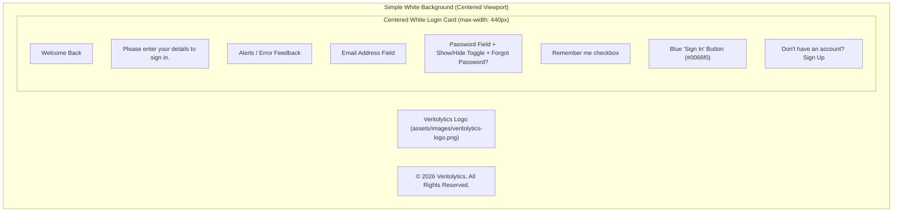

# Veritolytics – Member Sign-In Design Documentation

This document records the visual specifications and architecture for the **Veritolytics** member authentication system, including both the active **Simple & Clean** centered interface and the alternative **Premium Split-Screen** layout.

---

## 1. Active Design: Simple & Clean Centered Portal

The production active login page at [`auth/login.php`](../auth/login.php) uses a distraction-free, responsive layout optimized for conversion and accessibility.

### Visual Layout & Structure

### Key Elements & Styling
- **Background**: Clean, distraction-free `#ffffff` background with responsive vertical centering.
- **Top Brand Logo**: Displays `assets/images/veritolytics-logo.png` centered above the login card.
- **Login Container**: Elevated card (`border: 1px solid #e2e8f0; border-radius: 16px; box-shadow: 0 10px 25px rgba(0,0,0,0.05); max-width: 440px;`).
- **Heading**: **Welcome Back** — *Please enter your details to sign in.*
- **Email Field**: Rounded input with placeholder `Enter your email address`.
- **Password Field**: Interactive password visibility toggle (eye icon) with **Forgot Password?** link pointing to [`auth/forgot-password.php`](../auth/forgot-password.php).
- **Call-to-Action**: Solid royal blue button (`#0066f0`) with hover elevation.
- **Registration Link**: Seamless redirect to [`auth/register.php`](../auth/register.php).
- **Minimalist Footer**: `© 2026 Veritolytics. All Rights Reserved.`

---

## 2. Alternative Layout: Premium Split-Screen Design

A high-converting 69/31 split-screen desktop layout is preserved and available as a plug-and-play template at [`docs/templates/login-split-screen.php`](templates/login-split-screen.php).

### Features
- **Left Hero Section (69% width)**:
  - Uses the full-resolution corporate photograph [`assets/images/auth-hero-bg.jpg`](../assets/images/auth-hero-bg.jpg).
  - Deep royal blue overlay gradient with subtle ambient blur.
  - Floating glassmorphism card:
    - *Empowering Your Voice, Rewarding Your Time.*
    - Benefit bullets: Instant Payouts, Bank-Level Encryption, Exclusive B2B Studies.
    - Statistics footer: **5,000+ Early Members**, **$250+ Paid Daily**, **ISO 20252 Ready**.
- **Right Login Section (31% width)**:
  - Clean white container with responsive vertical centering.
  - Prominent brand header with direct authentication inputs.
  - Consistent CSRF protection and session validation.

---

## 3. Security & Architecture Specifications

- **Backend Architecture**: Pure Core PHP 8.2+ without bloated framework dependencies.
- **Password Verification**: Secure bcrypt hashing with `password_verify()`.
- **Session Continuity**: Backed by `DatabaseSessionHandler` in MySQL to guarantee session persistence across Vercel serverless requests.
- **CSRF Token Protection**: Cryptographically secure, per-session CSRF tokens validated via timing-safe `hash_equals()`.
- **Identity Alias Support**: Seamless compatibility between `@veritolytics.com` and `@veritopinion.com` email handles.
